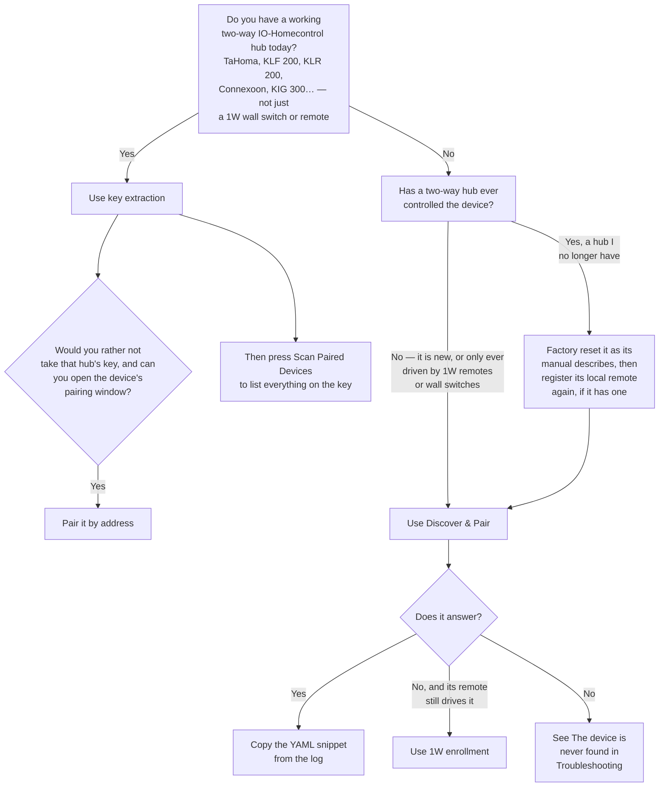

# Pairing
<!-- doxygen-label: pairing -->

Getting a device onto your hub. There are five routes, and picking the right one first saves more
time than anything else on this page.

## Which route should I use?

| Your situation | Route |
|---|---|
| A two-way hub controls the device today: a TaHoma, Connexoon, Connectivity Kit, KLF 200, KLR 100, KLR 200, KLR 300, KIG 300 or similar | [Key extraction](key-extraction.md), then [Scan Paired Devices](scan-paired-devices.md) |
| The device is new or factory reset, or only wall remotes have ever driven it | Discover & Pair, on this page |
| The device is a connected radiator or towel dryer of the Atlantic group | Discover & Pair from the device's own menu; see [Devices that hand over their own key](#devices-that-hand-over-their-own-key) |
| A two-way hub holds the device, you would rather not take that hub's key, and you can open the device's own pairing window | [Pairing a device by address](#pairing-a-device-by-address) |
| A two-way remote shares its key when you start a mode on it, and you know its node ID | [`pull_key`](configuration/actions.md#pull_key) |
| The device only takes one-way commands, or never answers Discover & Pair while a 1W remote still drives it | [1W enrollment](configuration/oneway-transmit.md#enrolling-this-hub-as-a-controller) |



**Key extraction is the route whenever you already own a two-way hub** — one that runs its own
"add a device" wizard. It recovers the same `node_id`/`system_key` your devices already trust, so
nothing leaves its paired state and every device on that installation appears at once. Most field
reports of a device that "never responds to discovery" have been resolved this way. A 1W-only wall
switch or remote (a VELUX KLI, a Somfy Smoove) does not run that wizard and has nothing key
extraction can recover from it;
[Hubs you can take a key from](supported-devices.md#hubs-you-can-take-a-key-from) lists the ones
that qualify. See [Key extraction](key-extraction.md).

**Discover & Pair** is the route for a device that is genuinely unclaimed: new, or factory reset,
with no hub holding its key.

**Pairing a device by address** is the route for a claimed device when you would rather not involve
the hub that holds it. It skips discovery, so it needs the device's ID in your YAML and its pairing
window open. See [Pairing a device by address](#pairing-a-device-by-address).

**1W enrollment** is the route for a device that takes only one-way commands, such as a VELUX
interior blind behind a KLI remote. The hub joins the device as one more remote: you get open, close
and stop, and no position feedback. [Supported devices](supported-devices.md) marks these devices
`1W`. See [Sending 1W commands](configuration/oneway-transmit.md).

## Discover & Pair

A flag in the `home_io_control:` block adds a Home Assistant button that starts discovery and
pairing:

```yaml
home_io_control:
  # ...
  discover_and_pair_button: true
```

It adds two entities: the "Discover & Pair" button (`config` entity category) and its companion
"Last Pairing Result" diagnostic sensor, the machine-readable outcome of the most recent attempt.
Both live on the hub's own ESPHome device and, like every other hub-level entity (the arming
switches, Scan Paired Devices, tuning numbers/selects), take no `device_id:` of their own.

[Getting started](getting-started.md) covers choosing the hub's `node_id` and `system_key` and
flashing this flag. From there:

1. Put exactly **one** device into pairing mode. The gesture depends on the device; its page under
   [Supported devices](supported-devices.md) or its own manual has the details.
   - **A device with a reachable PROG button of its own:** usually a 2 second press of that button.
   - **A device whose button is out of reach**, such as a motor inside a tube or a pergola, or a
     receiver with no button: hold PROG on a remote **already registered to that device** for about
     2 seconds, and **let go at the first jog** (or blink). Holding on longer can remove the remote.
     Straight after a power cut, it can factory reset the device.
   - If one remote drives several devices, power the others down first. A single PROG press puts
     every device registered to that remote into pairing mode at once.
   - Give each attempt **one** PROG press. On a remote that is already registered, a PROG press is
     also the add/remove step, so pressing it again while the device is still in pairing mode can
     close the window the first press opened.
2. Press **Discover & Pair** in Home Assistant straight away. Some devices close their pairing
   window after a few seconds.
3. Watch the ESPHome log. On success it prints a ready-to-paste YAML snippet with `io_device_id`,
   `io_device_type` and `io_subtype`; otherwise a follow-up message says why no snippet could be
   generated.
4. Paste the snippet into your YAML and give the entity a name. If the log printed a raw numeric
   type such as `0x11`, keep that exact value. Don't add
   device entries with made-up IDs such as `000000` ahead of pairing. The hub polls every device
   in the YAML, so a placeholder only produces failed exchanges in the log.
5. Reflash. The entity appears in Home Assistant and the hub starts polling the device for status.
6. If the log says the type is unsupported or the discovery metadata was incomplete, follow its
   guidance and open a GitHub issue with the raw type/subtype, the device model and the pairing
   log.

Between the device answering discovery and the key exchange starting, the hub sends a
discover-confirm frame directly to that device and waits up to a few seconds for its
acknowledgement — the same handshake every real controller in this project's corpus performs
before proceeding. It never blocks pairing on its own: a refusal, a timeout, or nothing at all
still lets the attempt continue. If a specific device seems to dislike this step,
`pairing_discover_confirm: skip` in the `tuning:` block sends nothing at that point —
see [Radio tuning](configuration/tuning.md).

**Expect this to take a few goes.** The hub retries discovery three times per press, and it is
still common to need two or three presses because the timing between PROG and the button matters.
Press PROG again and repeat before you change any settings.

Discovery goes out behind a short preamble, the same duration a directed command to an always-awake
device gets, because some devices (VELUX solar roller shutters among them) answer nothing else. The
hub uses that length for the pairing frames that follow as well. A device that needs the 1024-byte
wake-up burst takes it through
[`pairing_discovery_preamble_ms`](configuration/tuning.md#pairing_discovery_preamble_ms).

**If the device never answers**, read
[The device is never found](troubleshooting.md#the-device-is-never-found) before touching
[Radio tuning](configuration/tuning.md). A device that already belongs to a hub has nothing left
to answer a discovery with, and no tuning changes that; key extraction does, and so does pairing it
by address.

## Pairing a device by address

A device that already holds a hub's key answers no discovery, so Discover & Pair never finds it.
The rest of the flow needs no discovery: the `0x31` key init, the device's `0x3C` challenge, the
`0x32` key transfer and its `0x33` confirm are all addressed to one device. The
[`pair_device`](configuration/actions.md#pair_device) action runs that exchange on its own, aimed
at a device your YAML declares.

It needs the device's ID in your YAML, and its pairing window open by the gesture its own manual
describes. Write the entity by hand the way
[The device is never found](troubleshooting.md#the-device-is-never-found) describes when discovery
is no help: turn on the `io_capture` log tag, operate the device from the hub or remote that drives
it today, and read the `src=`/`dst=` of its frames.

> [!WARNING]
> **The hub that held the device loses it.** Afterwards the device holds this hub's key, or the
> entity's own [`system_key:`](configuration/index.md) when it declares one, and nothing in this
> route can give it back. Do not use it on a device you still need on that hub.

The device's one-way remotes keep working, since those are a separate stack, and nothing is reset.

Nothing in this route is broadcast, so devices that share a circuit can be done one after another:
open the window, then call the action once per device ID.

## Devices that hand over their own key

Some devices keep a key of their own and refuse a pushed one. An Atlantic AGILIA IO radiator in its
display's pairing mode answers discovery as a remote controller, so `pairing_key_transfer: auto`
(the default, see [Radio tuning](configuration/tuning.md#pairing_key_transfer)) pulls its key
instead of pushing yours. After the device proves the key, the hub reads the address after the
pairing node, where an AGILIA's heater usually sits, and runs a roll-call under the key when that read
gets no answer. It logs one report between a `DEVICE KEY RECEIVED -- DO NOT SHARE IT` line and an
`END OF DEVICE KEY REPORT` line. [Atlantic AGILIA IO](devices/atlantic-agilia-io.md#pairing-a-radiator)
has the radiator's menu steps. Each device gets a paste-ready block that includes its own `system_key:`:

```
  climate:
  - platform: home_io_control
    name: "My Device"
    io_device_id: "B6BDFC"
    io_device_type: "electrical_heater"
    io_subtype: 1
    system_key: "<32 hex characters>"
```

Paste the block into your YAML, move the key into `secrets.yaml` (`system_key: !secret ...`), and
flash. Until you reboot the hub already controls the registered devices with that key. The key
appears in the device log only: the Last Pairing Result sensor and the Home Assistant events show
the key check value at most, so it is safe to share those. Remove the key from any log you post.
Pair each radiator in turn: an AGILIA IO has a key of its own, while the heaters of a Cozytouch
installation all hand over that installation's key.

A [Freebox Delta](devices/freebox-delta.md) hands over its installation's key the same way, with
`pairing_key_transfer: pull` and "Share your network" open in the Freebox app.

A controller that shares its key only from a mode you start on it, and does not answer discovery in
that mode, is asked directly with the [`pull_key`](configuration/actions.md#pull_key) action and
its node ID. The log names every controller the hub overhears (`Heard a request from`), so pressing
a button on the controller shows its ID.

## Diagnosing a failed pairing attempt

`discover_and_pair_button: true` also creates a companion **"Last Pairing Result"** diagnostic text
sensor alongside the button. It updates after every attempt with a frozen, machine-readable
summary:

```
v1; outcome=paired; phase=complete; node=30E1F2; type=vertical_exterior_awning; attempts=1; lbt=0; dur_ms=842; heard=3; advice=none; check=-
```

| Field | Meaning |
|-------|---------|
| `outcome` | How the attempt ended; the values are listed below. |
| `phase` | The furthest stage the pairing state machine reached. |
| `node` / `type` | The node ID and type of the device that answered discovery, or `-` if nothing was paired. After a key pull this is the node that handed the key over; an AGILIA's heater appears only in the log report. |
| `attempts` | Number of discovery commands sent. An attempt started by the `pull_key` or `pair_device` action sends none, so it reports 0. |
| `lbt` | Listen-before-talk retries consumed across the whole attempt; a channel-busy indicator. |
| `dur_ms` | Attempt duration in milliseconds. |
| `heard` | Total RX events seen, including ones the pairing classifiers rejected and a 1W gesture overheard just before the window opened. |
| `advice` | Comma-separated advisor codes, described below, or `none`. |
| `check` | The six-hex-digit check value of a key this attempt pulled and proved (a controller's own proof, or devices that answered under it), or `-`. Never the key itself. |

| `outcome` | Meaning |
|---|---|
| `paired` | The device holds the key and is registered. |
| `no_response` | Nothing answered discovery. |
| `invalid_response` | Traffic was heard during discovery, but no valid discovery reply. |
| `key_exchange_failed` | The key was sent but not confirmed. The device may hold it anyway, so run [Scan Paired Devices](scan-paired-devices.md) before retrying (issue #161). |
| `key_transfer_refused` | The device answered the key with an error; see the advisor codes. |
| `key_received` | A key pull got a different key and the device proved it, but no device that holds it could be registered; see [`pairing_key_transfer`](configuration/tuning.md#pairing_key_transfer). |
| `hub_key_returned` | A key pull got the hub's own key from a node no platform drives, and no device that holds the key answered. |

The format is stable and versioned (the `v1;` prefix), so an automation can alert when `outcome`
is not `paired`.

Discover & Pair blocks the hub while it runs, so a press made during an attempt is handled only
after it ends. The hub ignores a press it handles within a second of an attempt ending and logs that
it did: put the device back into pairing mode and press again.

The log also gets a full human-readable summary of every TX, RX, rejected RX, listen-before-talk
deferral and phase event, plus a total channel-hop count. When the overheard traffic tells a story,
one or more **pairing advisor** WARN lines turn it into a diagnosis. The advisor also considers the
15 seconds *before* the button press: a PROG press completed just ahead of it is 1W traffic, not
RF silence, and is reported as `1w_traffic`.

### Advisor codes

Each code names what the hub overheard and what to do about it.

#### `1w_traffic`

A 1W remote was seen performing 1W pairing (a broadcast to `00003F` with a 1W pairing command
byte). The broadcast does not identify a target, so this fires on any 1W pairing gesture in range.

A remote's PROG gesture was heard, and no device answered. That shows a gesture happened, **not**
what state the device is in: the same frames have come just before a successful pairing, too.
Check in order:

1. If a **two-way** hub already controls the device (a TaHoma, KLF 200, KLR 200, KIG 300, and
   similar; not a 1W wall switch or remote), it is almost certainly paired to that hub: use
   [key extraction](key-extraction.md).
2. Was the PROG press on a remote *already registered to this device*, released at the first jog?
   A longer hold can remove the remote, or reset the device straight after a power cut. On such a
   remote a PROG press is also the add/remove step, so give each attempt one press: a second press
   while the device is still in pairing mode can close the window the first press opened.
3. Was this the only device in pairing mode? One remote often drives several devices.
4. A Double Power Cut or factory reset is not a pairing gesture on its own. Afterwards a device
   with a local remote expects that remote to be registered again, as its manual describes, so do
   that first, then repeat 2. Some families document a separate gesture: a VELUX SSL has a physical
   **P** button that opens a 10-minute 2W registration window (see
   [VELUX INTEGRA](devices/velux-integra.md)).

#### `channel_busy`

Listen-before-talk retries were exhausted and the same source was heard repeatedly during the wait.

A repeating beacon (usually a nearby remote or sensor) is flooding the channel and delaying discovery transmissions. Try again, or tune `lbt_rssi_threshold_dbm` — see [Radio tuning](configuration/tuning.md).

#### `foreign_controller`

A discovery response (0x29) was seen addressed to a node ID that is not this hub's.

Another controller (a TaHoma, say) is pairing the same device right now. Wait for it to finish, or make sure yours is the only controller with the device in pairing mode.

#### `key_push_not_accepted`

The device answered the hub's key with `COMMAND_UNKNOWN`, or it answered discovery as a remote controller (node type 1023) and the key step failed.

The device does not take a pushed key in this mode. It may hand over its own key instead: set `pairing_key_transfer` to `pull` or back to `auto`, described in [Radio tuning](configuration/tuning.md#pairing_key_transfer). An Atlantic AGILIA IO radiator does this in its display's pairing mode, and `auto` pulls it (issue #165).

#### `key_refused`

The device answered the hub's key with any other error. The message names the code.

If the device was paired before, run [Scan Paired Devices](scan-paired-devices.md) before retrying: it may already hold a key.

#### `key_pull_not_offered`

The hub pulled (`auto` for a remote controller, or `pull`), and the device answered the key request with an error.

The device does not hand out its key. Set `pairing_key_transfer: push` to pair it normally. A Somfy Izymo dimmer answers this way.

#### `key_pull_unproven`

The hub pulled, and the device sent a key but did not prove it holds that key: it answered the challenge wrongly, or never answered and no device answered a roll-call under the key either.

The hub prints no key. Post the `Key pull check` line in your issue: it contains no key.

#### `pulled_key_received`

The hub pulled, the device sent a different key, the device or a device answering a roll-call under it proved the key, and that roll-call found no device the hub could register.

The log prints the key once. Put it into the `system_key:` of the entity that controls the device, flash, and run [Scan Paired Devices](scan-paired-devices.md): the log prints its YAML snippet. Each device of this kind keeps its own key, so compare their `Key pull check` values.

#### `hub_key_no_responder`

The hub pulled, the device sent the hub's own key, it has no platform of its own, and no device that holds the key answered.

The device that pairs is not always the one to control: an Atlantic radiator's heater sits at the next address. Press [Scan Paired Devices](scan-paired-devices.md), and again if nothing answers; it prints the YAML block of each device that holds the key.

#### `pull_key_proven`

The [`pull_key`](configuration/actions.md#pull_key) action pulled a different key and the controller proved it holds it.

The key is in the device log, printed once, not in this result. Put it into the `system_key:` of the entity of each device the controller operates. No search for devices was made.

#### `pull_key_own_key`

The `pull_key` action pulled the hub's own key: the controller already shares this hub's key. Add its devices by their IDs with the hub's `system_key:`.

#### `pull_key_refused`

The controller answered the `pull_key` request with an error; the message names the code. Start the controller's key-sharing mode and run the action again within its window.

#### `pull_key_unanswered`

The controller sent no key to the `pull_key` request. Check the node ID by pressing a button on the controller and reading it from the log, start its key-sharing mode, and run the action again within its window.

#### `rf_silent`

Nothing at all was heard on any channel during the whole discovery window.

Either the radio is not receiving (antenna, wiring, wrong tuning), or the channel was simply quiet for those few seconds. Look at the rest of the log first. If it shows other IO-Homecontrol frames being received (your remotes, a neighbour's devices), the radio works, and this reads as "the device did not answer". Only if nothing is ever received, check the antenna and radio tuning before pressing PROG again.

## See also

- [Key extraction](key-extraction.md) — the route for a device that already has a hub
- [Scan Paired Devices](scan-paired-devices.md) — listing every device that holds your key
- [Diagnostic entities](diagnostic-entities.md) — what the companion sensors report
- [Radio tuning](configuration/tuning.md) — when discovery gets no answer
